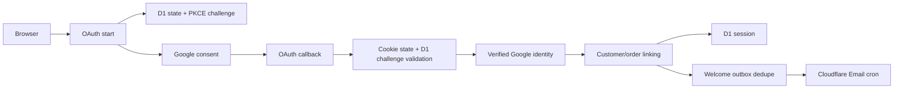

# Customer auth upgrade plan

## Overall assessment

The production flow now has a sound baseline: Google OAuth uses authorization
code + PKCE, state is stored as a short-lived hashed D1 challenge and bound to
a host-only cookie, Google must report a verified email, sessions are opaque
and server-side, and account pages never enter public/CDN caches. Verified
Google email can safely link an existing guest or magic-link customer and
attach prior orders without exposing order bearer tokens.

Welcome delivery now follows the same durable outbox model as order email. The
queue stores only a customer aggregate reference, resolves the current verified
address at dispatch time, retries transient failures, and uses a stable dedupe
key so repeated logins cannot send duplicate welcomes.

## Completed production baseline

- Dedicated Google Cloud production project and Web OAuth client.
- Published external consent screen with homepage, privacy URL and authorized domain.
- One active Google client secret in Google; ID and secret stored only as Cloudflare Worker Secrets.
- Real Google sign-in verified against production, including identity linking, session creation and existing order access.
- Missing/mismatched OAuth state cookie rejected before token exchange.
- Canonical and localized account pages return browser/CDN `no-store` headers.
- Localized welcome template for Vietnamese, English, Japanese and Chinese.
- Durable customer welcome topic, migration backfill, retry, lease and dedupe behavior.
- Regression coverage plus full Astro check/build/smoke validation.

## Phase 1 — account security and recovery

Priority: next release.

- Add an account security page listing active sessions with device/time summaries.
- Add revoke-one and revoke-all session actions with same-origin mutation checks.
- Wire the existing login-alert template for first login from a new device fingerprint.
- Add explicit identity management: show linked providers, safe Google unlink rules,
  and require at least one verified recovery method before unlinking.
- Record identity-linked, identity-unlinked, session-revoked and recovery events in
  `shop_customer_security_events`.
- Add customer-facing account export and deletion requests with delayed, auditable execution.

Exit criteria: a customer can understand and revoke account access without operator intervention,
and every sensitive identity/session change is observable and tested.

## Phase 2 — OAuth protocol hardening and environments

Priority: after Phase 1.

- Add an OIDC nonce and validate the returned ID token (`iss`, `aud`, `exp`, `nonce`)
  in addition to the current userinfo lookup.
- Define explicit provider timeout budgets and privacy-safe error metrics for start,
  exchange, profile and account-link stages.
- Split local/staging/production into separate Google clients and redirect URI allowlists.
- Add a documented quarterly secret-rotation drill and emergency revocation runbook.
- Add automated production probes for start redirect shape, callback fail-closed behavior,
  consent publication status and cache headers.

Exit criteria: protocol validation does not rely on one provider endpoint, environments cannot
share credentials accidentally, and rotation is rehearsed rather than improvised.

## Phase 3 — authentication product experience

Priority: product iteration.

- Preserve locale on every OAuth and magic-link error redirect.
- Add a post-signup onboarding state rather than dropping every new customer directly
  onto the generic dashboard.
- Show clear identity-link outcomes when a verified Google email attaches prior guest orders.
- Move magic-link delivery to a secure asynchronous design by retaining only encrypted,
  short-lived delivery material; never place raw login URLs in the outbox.
- Add resend/rate-limit UX, delivery diagnostics and a recovery path when email is delayed.
- Add Terms of Service and support URLs to Google branding when the legal copy is approved;
  add a logo only when the Google verification impact is accepted.

Exit criteria: new and returning customers understand what happened, can recover from provider
or email delay, and retain the same locale and return destination throughout the flow.

## Phase 4 — operations and analytics

Priority: once traffic justifies it.

- Dashboard OAuth conversion by stage using anonymous event counts, not email addresses.
- Alert on callback failure spikes, dead-lettered welcome email and unusual account-link rates.
- Add an operator tool to replay safe dead-letter messages without exposing recipients or bodies.
- Define SLOs for login success, callback latency, email queue delay and session lookup latency.
- Run periodic orphan checks across customers, identities, sessions, orders and outbox rows.

Exit criteria: failures are detected before support reports them and operators can diagnose the
stage without reading credentials, tokens, email bodies or other sensitive customer data.
