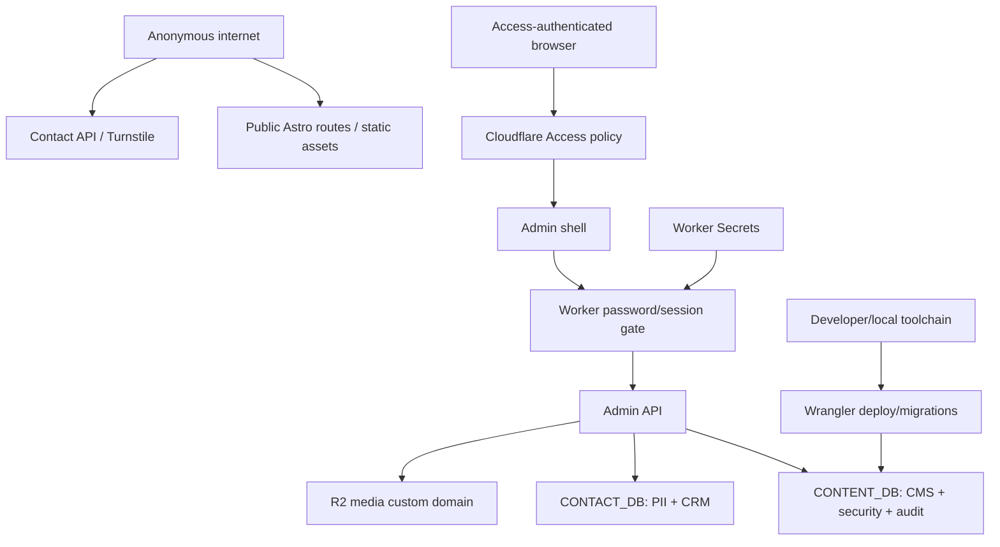
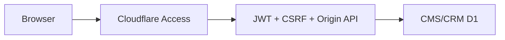
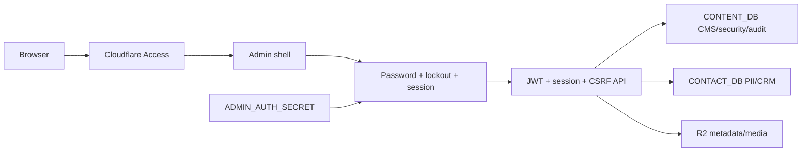

# Security Hardening Review: TUNG Admin

This is a derived design and threat-model document for the next TUNG release. It is not evidence that the proposed controls are already deployed. We should treat the current production version as protected by Cloudflare Access and the existing Worker checks, then close the gaps below with tests and production verification before calling the release complete.

## Evidence Basis

We inspected the current source and the repository contracts at the time of this review:

| Evidence | Source or finding | What it establishes |
| --- | --- | --- |
| `E-ACCESS-001` | `src/lib/admin/auth.ts` — Cloudflare Access verification | The Worker verifies issuer, audience, expiry, signature, subject and allowlisted email before current admin operations. |
| `E-API-001` | `src/pages/admin/api/[...path].ts` — admin API boundary | CMS, CRM and media operations share Access and mutation CSRF/Origin checks, but there is currently no application password session boundary. |
| `E-CMS-001` | `content-migrations/0001_content_cms.sql` — CONTENT_DB schema | Revisions, localizations, media, audit logs and site state are separate from CONTACT_DB and can support an owner security state. |
| `E-PRIVACY-001` | `CONTACT_CRM.md` and `src/lib/admin/contact-repository.ts` | Contact PII is intentionally private/no-store, keyset-paginated and separated from content; raw IP is not a CRM display field. |
| `E-VALIDATION-001` | `src/lib/admin/validation.ts` | Structured blocks, safe public URLs, raster media and repository-reference rejection already exist as server-side controls. |
| `E-UI-P0-001` | Cross-audit of `src/pages/admin/index.astro` and generated editor/list DOM | Astro-scoped CSS does not reliably style DOM created later by client JavaScript. This is a production usability defect, not a security bypass by itself, but it can hide security/error state and block safe operation. |
| `E-UI-P0-002` | Cross-audit of admin dirty/publish state | A dirty editor can still target an older saved draft revision, so the owner may publish content different from the content visible on screen. This is an integrity and operator-trust risk. |
| `E-UI-P0-003` | Cross-audit of mobile action layout | The mobile sticky action region can occupy approximately 40% of the viewport and cause horizontal overflow, obscuring review context and increasing accidental-action risk. |
| `E-UI-P1-001` | Cross-audit of admin accessibility/workflow | Persistent locale error summary, contact mobile detail focus, block focus retention, skip link and a single sticky surface are missing or incomplete. |
| `E-BLOG-001` | `src/components/pages/PostPage.astro`, `src/layouts/BaseLayout.astro` and existing Blog/Lab routes | The current publication model does not distinguish research `lab` entries from durable `blog` articles in route/metadata filtering; some covers are absent and Person JSON-LD lacks a stable `@id`. |
| `E-TOOL-001` | Plugin/tool availability review | MagicPath is unauthenticated; Mixpanel Headless is not installed; Remotion is video-specific. These are constraints on audit/instrumentation, not reasons to add unverified dependencies. |

The evidence is source-derived and audit-derived rather than a sealed Codex Security scan. We have not measured production attack rates or Worker CPU for password derivation; those remain explicit validation work.

## Constraints

- Cloudflare Free is the deployment boundary. We retain Workers Static Assets, D1, R2, Access, Turnstile and existing custom domains.
- The current Worker has a 10 ms CPU invocation target and D1 query budget; a password KDF must be benchmarked rather than selected by a generic server assumption.
- The application has one owner identity, not multi-tenant administration.
- Existing Zoho MX/SPF must not change. Automated Cloudflare email is out of scope under the current plan.
- Public source-location information and repository links remain forbidden.
- Contact data remains in `CONTACT_DB`; security/content state remains in `CONTENT_DB`.
- We preserve optimistic locking, immutable revisions, soft delete/restore, CSRF/Origin checks, raster upload validation and audit logging.
- The password gate is additive to Access. We do not silently fall back to Access-only if its migration or secret is missing.

## Opportunity Portfolio

| Opportunity | Evidence | Options | Recommendation | Proposal |
| --- | --- | --- | --- | --- |
| Establish a second owner authentication boundary | `E-ACCESS-001` Access verification; `E-API-001` shared API gate; password/session gap | 1. Access plus local guards; 2. Access plus D1 password/session/lockout; 3. Access plus external step-up IdP | Option 2 under Cloudflare Free and the owner's explicit password requirement | This document, “Second-factor application gate” |
| Preserve operator/content integrity while redesigning admin | `E-UI-P0-001`, `E-UI-P0-002`, `E-UI-P0-003`, `E-UI-P1-001` | Global bundled admin stylesheet; save-before-publish transaction; persistent/focus-managed workflow | Implement all three as tactical controls in the same release; do not defer P0 work | This document, “Admin integrity and safe operation” |
| Reduce public publication/SEO attack and trust errors | `E-BLOG-001`, `E-VALIDATION-001` | Keep one mixed surface; separate `meta.surface` routes and feeds | Canonical `/blog` for `surface=blog`, canonical `/lab` for `surface=lab`, cover/alt/Person ID checks | This document, “Public publication boundary” |

## Threat Model, Trust Boundaries, and Assumptions

### Overview

TUNG is an owner-operated multilingual portfolio and CMS. Anonymous visitors read public Astro pages and submit contact forms. The owner signs in through Cloudflare Access, then edits published content, media, settings and contact records through Worker APIs. The highest-value assets are the ability to publish public content, contact PII, R2 media, D1 integrity, the Access identity, the second-factor verifier/session state and Worker Secrets.

The security objective is not to make a single password an internet-wide identity system. It is to ensure that a request must cross two independent application boundaries—Cloudflare Access and the local password session—before it can read or mutate owner data, while preserving a usable owner workflow on Cloudflare Free.

### Trust boundaries



We treat the following as untrusted even when they arrive in an authenticated request: URL/path segments, query strings, JSON block data, uploaded bytes, Origin and Fetch-Site headers, user-agent, Access assertion text before signature verification, analytics properties and any draft content typed by the owner. Access policy, Worker Secret storage, D1/R2 bindings and the owner's device are assumed to be operator/deployment-controlled. A full Cloudflare account compromise or malware on the owner device is outside the application threat model, but the residual risk is stated below.

### Security invariants

1. Every data-bearing admin response requires a valid Access identity and a non-expired application session bound to that same Access subject/email.
2. Every admin mutation additionally passes same-origin, same-site and CSRF checks.
3. Password verifiers never contain the clear password; session tokens are random and only their purpose-separated HMAC hashes are stored.
4. A missing security secret or migration fails closed; it cannot downgrade to Access-only behavior.
5. Login lockout state contains only HMAC fingerprints and bounded counters, never raw IP.
6. A dirty editor cannot publish an older revision; publish always names the exact revision returned by the successful save.
7. Public readers return only published, non-deleted, locale-specific revisions; drafts and admin data are never public.
8. Public URLs and content reject repository/source-location references.
9. Contact PII never enters analytics, URLs, local storage or public cache.
10. Public article metadata points to the route selected by `meta.surface`, includes a cover image and stable Person identity, and never conflates Blog articles with Lab research.

### Attacker stories and out-of-scope stories

In scope:

- A visitor sends malformed JSON, oversized input, unsafe links, HTML-like text, forged Origin or CSRF values, or malicious media bytes.
- An attacker obtains an Access-authenticated browser session or convinces an Access user to open a malicious page and attempts to reuse that identity against admin APIs.
- A password-guessing script uses the valid Access identity, rotates source IPs or attempts to exploit a missing lockout.
- A stale browser tab publishes an older CMS revision after another tab changed it.
- A public crawler receives the same slug under the wrong surface, sees duplicate/mismatched canonical metadata or indexes draft/source-location text.
- A contact sender tries to place PII into analytics or URL search state.

Out of scope for this application layer:

- A complete compromise of the Cloudflare account, Access control plane, D1/R2 service or Worker Secret store.
- Malware or a browser extension that reads the owner's password before HTTPS submission.
- A deliberate owner publishing a malicious but valid HTML-free block; the editor still needs human content review.
- Availability during a regional Cloudflare outage; the app should fail honestly and preserve local unsaved input, but it cannot create a second provider under the Free constraint.

## Attack Surface, Mitigations, and Attacker Stories

### Identity and session

`E-ACCESS-001` shows a useful Access JWT verification boundary, but Access alone does not satisfy the requested second password or contain a compromised owner session. The proposed gate verifies Access first, then derives a password verifier with a secret pepper and random salt, stores only HMAC session hashes, binds sessions to Access identity, expires them and records security audit events.

The main residual risk is the KDF/CPU tradeoff on Workers Free. We should calibrate PBKDF2 in a Worker-compatible benchmark and retain a strong minimum password policy; we must not claim a measured security margin until that benchmark runs. If KDF CPU exceeds the Free headroom, the release blocks rather than silently removing the gate.

### CSRF, request smuggling and authorization order

`E-API-001` already checks Access and mutation CSRF/Origin. The new order is important: bootstrap security status/setup/login may return only non-sensitive status, then every content/CRM/media/settings/revision endpoint calls the password-session check before opening D1 or R2. This limits the blast radius of a shell that is visible due to an Access misconfiguration. We continue to reject cross-site Fetch-Site values, unexpected content types, malformed paths and oversized bodies.

### Password guessing and intrusion

An allowlisted Access identity should not be treated as a sufficient rate-limit key. We use both the Access subject/email and an HMAC of the request fingerprint; five failed attempts in 15 minutes produce progressive 15/30/60-minute locks. Generic errors prevent password-state enumeration. No raw IP is retained, and the session is not hard-bound to IP.

### Content integrity and stale publish

`E-UI-P0-002` is an integrity failure even if the API's optimistic lock is correct: the browser can ask to publish the last saved draft while the owner believes the unsaved screen is being reviewed. The client must save the current serialized state, await the resulting revision/version and send that exact revision to the publish review. The server continues to verify revision ownership, all four locales and optimistic version. A dirty state or failed save blocks publish.

### Generated admin DOM and error visibility

`E-UI-P0-001` can hide status, lockout, validation or destructive controls because Astro-scoped CSS does not match nodes created after hydration. The style boundary moves to a bundled global admin stylesheet with stable selectors. `E-UI-P1-001` adds persistent, field-linked validation; focus retention; contact drawers; a skip link; and one atomic status region. We should treat these as safe-operation controls, not cosmetic polish.

### Media and public assets

The existing `E-VALIDATION-001` raster/signature checks and immutable R2 keys remain. The media picker adds usage inspection and prevents delete of referenced assets. Public static images use versioned immutable names; admin preview stays private/no-store. AI-generated art passes review before publication and never receives a secret or model credential in the browser.

### Contact PII and analytics

`E-PRIVACY-001` is preserved: PII stays in `CONTACT_DB`, list search is bounded and keyset-based, raw IP is not displayed, and replies use `mailto:`. The analytics taxonomy allows only locale/page/category/slug/milestone/success-category values. Admin routes, contact names/emails/messages, query strings and draft IDs are forbidden properties. Cloudflare Web Analytics remains the production dependency; Mixpanel Headless is not added without an installed runtime and explicit owner approval.

### Public publication and SEO

`E-BLOG-001` is addressed by making `meta.surface=blog` canonical at `/blog`, keeping `meta.surface=lab` canonical at `/lab`, isolating their feeds, rejecting surface/route mismatches, requiring Article image and localized alt, and using `https://tung.codes/#person` as the stable Person ID. Sitemap/RSS/canonical/hreflang must be generated only from published localized rows on the correct surface. This reduces duplicate-index and stale-content risk; it does not replace content review.

## Severity Calibration

### Critical

- An unauthenticated request reads or mutates contact PII, CMS revisions, R2 metadata or settings.
- A valid but non-allowlisted Access identity reaches an admin API because authorization is checked only in the browser or only on the shell.
- A public route exposes Worker Secrets, Access assertions, password/session material or a repository/source-location URL that enables a materially different attack path.

### High

- Password/session gate can be bypassed, fails open when the secret/migration is absent, or accepts a session for a different Access subject.
- Brute-force attempts are unlimited or lockout state can be reset by an attacker without a valid owner session.
- CSRF/Origin checks are missing for a mutation that changes public content, contact state, settings or media.
- A stale revision can overwrite a newer public revision without a `409`/review step, or a dirty editor publishes a revision other than the one visibly reviewed.
- A media upload bypasses MIME/signature/size checks and becomes active public content.

### Medium

- PII enters analytics, URLs, local storage or cache without exposing a full admin read.
- A publish validation error is hidden, not focusable or not localized, leading to accidental incomplete publication.
- Mobile drawer/action focus is lost, making a sensitive contact action appear to fail or causing duplicate submissions.
- A missing or mutable `meta.surface` can place a Lab note in Blog navigation or a Blog article in the research feed.

### Low

- A non-sensitive UI state has poor contrast, a decorative motion transition ignores reduced motion or a harmless static asset lacks an immutable cache hint.
- A dashboard count is stale while the underlying authorization and mutation paths remain correct.

## Hardening Options

### Option 1: Access plus local tactical guards (baseline)

We keep Access as the only identity boundary, retain JWT/CSRF/validation controls and repair the P0 admin operation defects. This is the smallest migration and preserves the existing D1 schema. It does not satisfy the requested second password or protect against a valid Access-session compromise; we include it only as a comparison baseline.



| Change | Before | After | Security consequence | Cost |
| --- | --- | --- | --- | --- |
| Identity | Access | Access | Same session compromise surface | Low migration |
| Data gate | Access check | Access + existing request checks | No new factor | No D1 schema |
| Operator integrity | Dirty/styled/mobile defects | Tactical UI fixes | Fewer accidental actions | Moderate frontend work |

Tradeoffs: performance and memory are neutral; reliability improves for UI workflows; operability stays simple. The security gain is insufficient for the explicit password requirement, so I would not choose this option except as an emergency rollback state while Option 2 is repaired.

### Option 2: Access plus D1-backed password/session gate (recommended)

This option adds a Worker-owned second boundary without introducing a paid service. Access proves the owner identity; the password verifies a separate secret known only to the owner; D1 stores verifier/session/lockout metadata; `ADMIN_AUTH_SECRET` prevents a D1-only disclosure from becoming a direct offline password check. All CMS/CRM/media/settings calls require both boundaries.



| Change | Before | After | Security consequence | Cost |
| --- | --- | --- | --- | --- |
| Identity | Access only | Access + owner password | A valid Access session alone cannot read admin data | Setup/password UX |
| Session | Access browser cookie | Short-lived purpose-separated app session | Limits replay and binds Access subject | D1 writes/cleanup |
| Guessing | Existing perimeter only | Identity + HMAC-fingerprint lockout | Bounded brute force without raw IP storage | Counter queries |
| Secret storage | Access config/secrets | Access config + Worker Secret + verifier metadata | D1-only disclosure lacks pepper | Secret rotation procedure |
| Operator integrity | Stale/hidden UI states | Save-before-publish, global CSS, persistent/focus-safe feedback | Lower accidental publication and denial risk | Frontend refactor |

Security improves materially, but the password gate cannot protect a browser extension that reads the password before submission or a fully compromised Cloudflare account. The principal engineering concern is KDF CPU under the Workers Free limit; we validate it in a Worker-like benchmark and keep the minimum password policy/pepper if the chosen PBKDF2 count must be conservative. Performance is neutral for public routes and adds one D1/session lookup to admin requests; memory remains bounded by small verifier/session rows; reliability improves through explicit fail-closed configuration, although an unavailable CONTENT_DB makes admin unavailable by design. Migration is additive and reversible at the Worker version level, but the security tables/secret must exist before owner unlock.

### Option 3: Access plus external IdP step-up/MFA

This option asks Cloudflare Access/IdP to enforce MFA or a second step, without an application password. It may be operationally stronger if the owner already controls a hardware-backed IdP and Access plan supports the policy, but it introduces external Dashboard configuration and an owner action outside this repository. It does not meet the requested in-app password setup and cannot be validated entirely by the Free Worker code.

| Change | Before | After | Security consequence | Cost |
| --- | --- | --- | --- | --- |
| Second factor | None beyond Access policy | IdP/Access MFA | Strong if hardware/IdP policy is configured | External account dependency |
| Application code | No D1 security state | Minimal session gate or Access assertion only | Less code, less local evidence | Configuration drift risk |
| Recovery | Worker/D1 workflow | IdP recovery policy | Depends on provider | Owner Dashboard coordination |

Performance is generally neutral in the Worker and memory neutral; reliability depends on the IdP and Access availability. Operability is higher because a production test must verify policy changes outside this source tree. This option should win only if the owner explicitly prefers managed MFA, can confirm Free-compatible Access policy behavior and accepts that in-app password setup is removed. It is not the current recommendation.

## Comparison and Recommendation Summary

| Dimension | Option 1: local guards | Option 2: D1 password/session | Option 3: external step-up |
| --- | --- | --- | --- |
| Security | Improves local defects; Access-session compromise remains | Adds independent password, lockout, expiry and audit | Potentially strongest with correctly managed IdP/MFA |
| Performance | Neutral | Admin-only D1 lookup/KDF on login; public neutral | Access/IdP latency outside Worker control |
| Memory | Neutral | Small bounded verifier/session/attempt rows | Neutral in Worker |
| Reliability | Simple; no new config | Fail-closed if migration/secret missing; explicit recovery | Depends on Dashboard/IdP availability and policy |
| Operability | Low | Moderate: secret rotation, migration, lockout support | High external configuration/owner dependency |
| Migration | Small | Additive migration + first-run setup + rollback | Access policy and owner coordination |
| Cloudflare Free fit | Yes | Yes if KDF/query benchmark passes | Unknown until account policy is verified |

I recommend **Option 2** because it directly addresses the owner's requirement, preserves Access as the primary boundary, fits the current D1/R2/Worker architecture and keeps all public routes free of paid dependencies. Option 1 is a tactical rollback state, not the target. Option 3 becomes preferable only if the owner chooses managed MFA over an in-app password and confirms the exact Access plan/IdP policy in production.

## Evidence Coverage and Residual Risk

| Evidence | Option 1 effect | Option 2 effect | Option 3 effect | Tactical work still required |
| --- | --- | --- | --- | --- |
| `E-ACCESS-001` — Access JWT verification | `mitigates` | `addresses` by retaining and composing with app session | `addresses` if policy is verified | Keep issuer/AUD/signature/email tests |
| `E-API-001` — shared admin API boundary | `mitigates` | `addresses` with session check before D1/R2 | `unknown` until external assertion/policy is verified | Test every data route and generic 401/403/503 |
| `E-CMS-001` — revision/audit schema | `unaffected` except UI | `addresses` via `0006` security state and audit reuse | `unaffected` | Keep optimistic lock and immutable history |
| `E-PRIVACY-001` — contact isolation | `mitigates` | `addresses` by gating contacts and preserving no-store | `unknown` until assertion is verified | Keep CONTACT_DB separation and no PII analytics |
| `E-VALIDATION-001` — structured input/media guards | `unaffected` | `unaffected` but remains required | `unaffected` | Keep server-side validation and R2 signatures |
| `E-UI-P0-001` — generated DOM style gap | `addresses` | `addresses` | `addresses` | Global admin stylesheet and generated-DOM test |
| `E-UI-P0-002` — stale publish | `addresses` | `addresses` | `addresses` | Save-before-publish contract and revision test |
| `E-UI-P0-003` — mobile sticky/overflow | `addresses` | `addresses` | `addresses` | 320/375/390 responsive browser checks |
| `E-UI-P1-001` — persistent/focus-safe admin feedback | `mitigates` | `addresses` | `mitigates` | Error summary, focus retention, drawer and skip link |
| `E-BLOG-001` — surface-aware Blog/Lab metadata | `unaffected` | `unaffected` | `unaffected` | Surface validation, separate feeds, correct canonical route, image, Person ID and sitemap |

Residual risks after Option 2 remains:

- The Access account/Cloudflare control plane remains a high-value external boundary.
- A stolen password plus a valid Access identity can still unlock the admin until the owner revokes sessions and rotates the password.
- D1 availability or quota exhaustion makes admin unavailable; the design refuses to guess or fall back to stale public data.
- Public R2 images are long-cacheable after upload; sensitive/draft-only assets must never enter that bucket.
- No automated email notification or retention scheduler is introduced under Free constraints.
- KDF strength must be re-evaluated if Workers CPU limits or browser threat assumptions change.

## Migration and Rollout

1. Capture fresh private D1 bookmarks/exports and record the current Worker rollback version.
2. Deploy code that recognizes the new security schema but fails closed with a generic configuration response until migration and secret exist.
3. Apply `content-migrations/0006_admin_security.sql` to `CONTENT_DB`; verify CONTACT_DB remains at migration `0005`.
4. Set `ADMIN_AUTH_SECRET` with `wrangler secret put` from a hidden local prompt. Never echo or document its value.
5. Complete one-time setup through the Access-protected browser, then test wrong-password/lockout/logout/revoke-all.
6. Apply `0007_seed_blog_series.sql` after copy/illustration review, then deploy the `/blog`, About, admin and SEO changes.
7. Verify Access exact/wildcard protection, admin no-store/noindex, all four locales, both public surfaces, surface-isolated RSS/sitemap, image headers and source-leak scan; do not introduce a Lab-to-Blog redirect.

Rollback is deliberately asymmetric:

- Worker-only regression: restore the previous stable Worker version after confirming the version ID.
- Content regression: unpublish or restore as a new draft; do not reverse or edit applied migrations.
- D1 damage: use the pre-release bookmark/export and document the recovery window.
- Media regression: point content to the prior immutable object; do not overwrite or broadly delete R2.
- Security configuration failure: keep admin data fail-closed until the migration/secret is repaired; never downgrade silently to Access-only.

## Validation Plan and Acceptance Criteria

### Security and intrusion

- Access JWT issuer/AUD/signature/expiry/subject/email tests remain green.
- No application password session means no CMS/CRM/media/settings/audit data, even when the shell HTML is visible.
- First setup is one-time, atomic and Access/CSRF/origin protected.
- Password verifier uses random salt, secret pepper, calibrated PBKDF2, generic errors and no sensitive logs.
- Session has Secure/HttpOnly/SameSite=Strict/Path=/admin/absolute expiry and identity binding.
- Five failed attempts trigger lockout; success/logout/password change/revoke-all/session mismatch audit without raw IP/token/JWT.
- Missing secret/schema returns 503 and never opens an Access-only path.

### Admin integrity and accessibility

- Generated editor/list DOM is styled through the global admin bundle.
- Dirty editor save completes before publish and the exact returned revision is reviewed/published.
- Persistent field/locale error summary is focusable; block operations retain focus; contact drawer returns focus; mobile actions fit without overflow.
- Keyboard, 200% zoom, reduced motion, screen-reader labels, skip link and no-JS fallback are checked at required viewports.

### Public publication and privacy

- `/blog` is canonical only for `meta.surface=blog`; `/lab` is canonical only for `meta.surface=lab`; neither surface redirects to the other.
- Existing five Lab seed entries remain on `/lab`; the four new article seeds remain on `/blog`; mismatched surface/slug routes return 404.
- Article JSON-LD has cover image, stable Person `@id`, canonical URL, locale, dates and breadcrumbs.
- Four seed posts have four independently edited localizations, useful depth, reviewed covers and localized alt.
- About portrait is optimized and no local Downloads path enters generated output.
- Analytics allowlist excludes admin and contact PII; public HTML/RSS/sitemap/bundle contain no repository/source-location references.

### Commands

```bash
npm run test:smoke
npm run check
npm run build
npx wrangler deploy --dry-run
npm audit --audit-level=high
```

The release is not accepted if any command fails, if an audit warning is unexplained, if D1 migration heads are unexpected, if Access wildcard coverage is missing, if any route is unintentionally 404/5xx, or if security can be bypassed by omitting the password session.

## Next Decisions

1. Keep Option 2 and confirm the Worker-like PBKDF2 benchmark threshold before production unlock.
2. Confirm whether the owner wants a future managed MFA path (Option 3) in addition to, not instead of, the application gate.
3. Decide whether a privacy-safe event adapter is needed beyond Cloudflare Web Analytics; no Mixpanel dependency is assumed today.
4. Revisit retention/notification workflows only with a concrete Free-compatible provider and explicit DNS/secret review.
