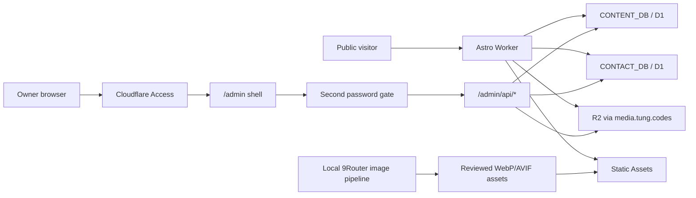
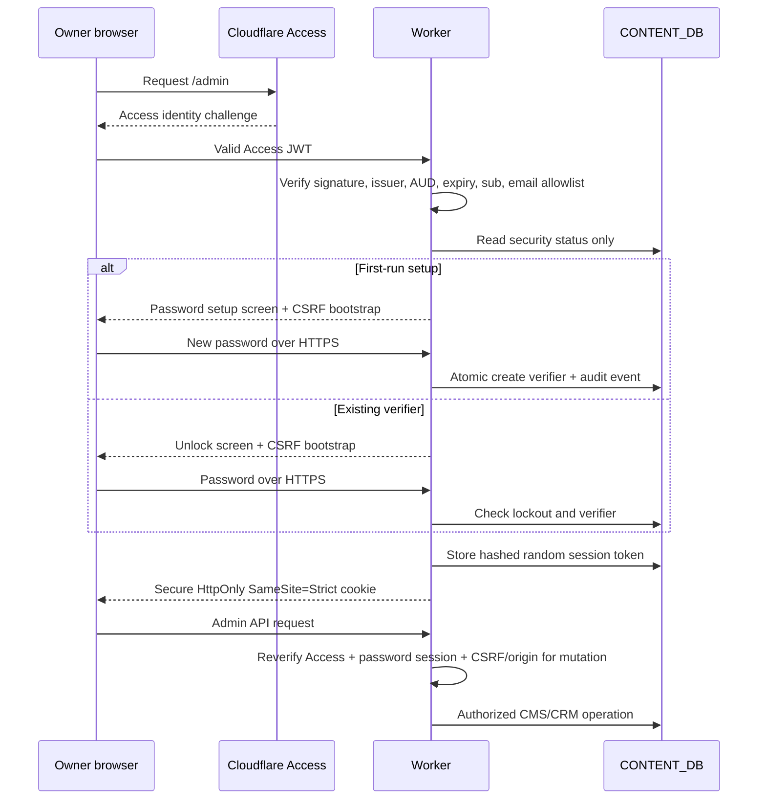

# TUNG Admin, Blog and Security Design Specification

Status: Approved implementation specification  
Date: 2026-07-24  
Production target: `https://tung.codes` (legacy compatibility: `tungjpstore.net`)  
Platform constraint: Cloudflare Free only  
Public locales: Vietnamese (`vi`, default and unprefixed), English (`en`), Japanese (`ja`), Simplified Chinese (`zh`)  
Admin language: Vietnamese

## 1. Outcome

This increment turns the existing portfolio CMS into a secure owner-operated publishing and contact control desk, while making the public About and Blog experiences feel like deliberate parts of the TUNG product system.

The release is complete only when all of the following work together in production:

1. Cloudflare Access remains the first identity boundary for `/admin` and `/admin/*`.
2. An application-level password is required after Access before any CMS, CRM, media or settings data is returned.
3. The owner can set that password during first-run setup without exposing it in source, chat, logs or Cloudflare variables.
4. The admin interface is calm, spacious and operational, with working responsive behavior and persistent validation guidance.
5. `/about` uses the owner-provided portrait as an editorial hero and presents a clearer personal/product narrative.
6. `/blog` is the canonical publication route for items whose `meta.surface` is `blog`, while `/lab` remains a separate research notebook for items whose `meta.surface` is `lab`.
7. The homepage includes a compact, high-quality latest-articles section.
8. The admin editor supports a professional four-locale blog workflow, SEO review, cover media, preview, safe save/publish and revision history.
9. Public output never reveals repository locations or source-hosting URLs.
10. The release passes security, i18n, SEO, accessibility, responsive, build and Cloudflare production checks.

## 2. Evidence Basis

The design is grounded in the current implementation and repository documentation, especially:

- `src/lib/admin/auth.ts`: Cloudflare Access JWT verification and CSRF primitives.
- `src/pages/admin/api/[...path].ts`: authenticated CMS, CRM and R2 API boundary.
- `src/pages/admin/index.astro`: current single-page admin shell and editor.
- `src/lib/admin/repository.ts`: revision, optimistic locking, publish and audit behavior.
- `src/lib/admin/validation.ts`: four-locale block and public URL validation.
- `content-migrations/0001_content_cms.sql`: CMS, media, audit and site-state schema.
- `src/components/pages/AboutPage.astro`: current About composition.
- `src/components/pages/LabPage.astro` and `src/components/pages/PostPage.astro`: current publication list/article foundation.
- `src/pages/[lang]/[...slug].astro`, `src/pages/sitemap.xml.ts` and RSS routes: locale routing and discovery.
- `CONTENT.md`, `DESIGN_SYSTEM.md`, `CONTACT_CRM.md`, `docs/ADMIN_REDESIGN_SPEC.md` and `docs/PHASE_RELEASE_STATUS.md`: existing product, content, privacy and release contracts.

The cross-audit identified three release-blocking admin defects:

- **P0 — generated DOM is unstyled:** Astro-scoped CSS selectors do not match substantial editor/list markup created later by client JavaScript.
- **P0 — dirty publish can publish stale content:** the current publish action can target the last saved draft while unsaved editor changes remain on screen.
- **P0 — mobile actions obstruct the workflow:** the sticky action region can consume roughly 40% of the viewport and cause horizontal overflow.

The audit also identified high-priority workflow/accessibility gaps:

- Publish issues need a persistent, focusable locale/field checklist rather than a disappearing toast.
- Contact detail needs a mobile drawer/dialog or a detail-first flow with deliberate focus movement.
- Block move/delete must retain keyboard focus and disable impossible movement controls.
- Whole lists must not be `aria-live`; a dedicated atomic status element should announce concise changes.
- The admin needs a skip link and a single coherent sticky surface.
- The editor needs a real media picker rather than requiring an opaque media ID.
- Existing sample articles are too thin for the intended editorial and SEO quality.
- Person JSON-LD needs a stable `@id`; every Article needs a cover image.

## 3. Constraints and Non-Negotiables

### 3.1 Cloudflare Free

- Use the existing Astro Worker, Static Assets, D1 databases and R2 bucket.
- Do not require Cloudflare Images, Stream, paid Workers features, a paid Access feature, or a paid email feature.
- Do not call the Cloudflare account REST API from public or admin runtime code.
- Keep admin responses `private, no-store`; keep public static assets cacheable and immutable when filenames are content-hashed or versioned.
- Keep D1 operations bounded and pagination/index aligned. No save on every keystroke.
- Keep `workers_dev: false`; custom-domain Access protection must not have a secondary public Worker hostname.
- Preserve Zoho MX/SPF and the current external `mailto:` reply workflow.

### 3.2 Content and privacy

- Public content may link to verified product websites, publication pages and contact pages only.
- Public content, metadata, RSS, sitemap, client assets and CMS seed data must not include repository URLs, clone instructions, source names or source-hosting references.
- Contact PII must not enter URLs, analytics, browser persistence, public cache or routine logs.
- Passwords, session tokens, Access JWTs, CSRF tokens and Worker Secrets must never be logged or persisted in browser storage.
- AI-generated illustrations require human review for text artifacts, logos, unsafe resemblance, licensing concerns, color fit, crop and localized alt text before release.

### 3.3 Localization

- Vietnamese remains the editorial source and default public locale.
- EN, JA and ZH must be independently edited, not literal machine translations.
- Slugs stay shared across locales.
- Publishing a project or post requires complete, valid content in all four locales.
- The admin chrome remains Vietnamese; only public content is authored in four locales.

## 4. Target Architecture



Static CSS, JavaScript, brand and article images should bypass the User Worker when possible. Dynamic public content routes, redirects, RSS, sitemap, contact API and all admin routes remain Worker-first through the reviewed `assets.run_worker_first` allowlist.

## 5. Admin Security Architecture

The target uses defense in depth. The password gate does not replace Cloudflare Access; it limits damage when Access policy, an Access session or the admin shell boundary is misconfigured or compromised.

### 5.1 Authentication sequence



### 5.2 Password setup and policy

- First-run setup is available only after a valid, allowlisted Access identity and only while no password verifier exists.
- Creation uses an atomic insert/guard so two requests cannot replace the first configured password.
- Password length is 14-128 Unicode code points and at most 512 UTF-8 bytes.
- Policy rejects leading/trailing accidental whitespace, known common passwords, a value derived from the site/domain/owner email, and low-variety repeated strings.
- Password composition guidance is shown, but length and common-value rejection matter more than forcing obscure symbols.
- The server derives separate cryptographic purposes from the `ADMIN_AUTH_SECRET` Worker Secret using HKDF-SHA-256 labels.
- The password verifier uses PBKDF2-SHA-256 over a secret-peppered password with a random salt. The default iteration count is recorded with the verifier and must be benchmarked against the current Workers Free CPU allowance before production. Access is the first factor and the pepper is outside D1, so a database-only leak does not provide a direct offline verifier.
- Password changes require the current password, create a new salt/verifier, revoke all other sessions and append an audit entry.
- The UI never displays, exports or stores the password.

### 5.3 Session design

- Generate a random 32-byte session token; only an HMAC-SHA-256 token hash is stored in D1.
- Cookie: `Secure`, `HttpOnly`, `SameSite=Strict`, `Path=/admin`, absolute maximum age of eight hours.
- Bind the session to the Access `sub` and normalized allowlisted email.
- Store an optional HMAC user-agent fingerprint to detect material client changes; never hard-bind the session to IP because legitimate mobile/network changes would cause fragile lockouts.
- Use a 30-minute idle window and update `last_seen_at` no more often than every 15 minutes to limit D1 writes.
- Logout revokes the current session and expires the cookie.
- Password change/revoke-all invalidates every outstanding session except the newly established replacement session.

### 5.4 Brute-force and intrusion controls

- Login state is keyed by both Access identity and a secret-HMAC fingerprint of the request IP; raw IP is never stored.
- Five failed attempts inside 15 minutes lock login for 15 minutes. Repeated windows increase the lock to 30 then 60 minutes, capped at one hour.
- Successful login clears active failure counters for that identity/fingerprint.
- Setup, login, logout, password change, revoke-all, lockout and session mismatch create security audit events without password/token/JWT contents.
- Authentication responses use stable generic errors so callers cannot distinguish password details or verifier state beyond the first-run setup screen already protected by Access.
- The admin shows recent security events, active-session count and a revoke-all action; it does not show raw JWT claims, raw IP or secret values.

### 5.5 Endpoint contract

The Access-authenticated bootstrap endpoints are:

```text
GET  /admin/api/session
GET  /admin/api/security/status
POST /admin/api/security/setup
POST /admin/api/security/login
POST /admin/api/security/logout
POST /admin/api/security/password
POST /admin/api/security/revoke-sessions
```

`GET /admin/api/session` may return the Access identity, CSRF bootstrap token and non-sensitive security status. It must not return CMS, CRM, settings, audit or media data before the password session is valid.

Every other `/admin/api/*` route requires:

1. Valid Cloudflare Access JWT and allowlisted identity.
2. Valid application password session bound to the same Access identity.
3. Origin, same-site and CSRF verification for mutations.
4. Existing content-type, body-size, media-signature and optimistic-lock validation.

### 5.6 D1 schema

`content-migrations/0006_admin_security.sql` adds:

- `admin_security_state`: singleton verifier configuration, salt, iteration count, setter identity and timestamps.
- `admin_sessions`: token hash, Access subject/email, optional user-agent hash, created/last-seen/expires/revoked timestamps.
- `admin_login_attempts`: identity/fingerprint key, window, failure count, lock level and lock expiry.
- Indexes for active session lookup, expiry cleanup and lockout lookup.

Security events reuse append-only `audit_logs` with `entity_type='admin_security'`. A scheduled task is not required for the first release; bounded opportunistic cleanup may delete expired sessions and expired attempt rows during successful security operations.

## 6. Admin Product Design

### 6.1 Information architecture

The admin is a Vietnamese operational workspace with these destinations:

```text
Tổng quan
Nội dung
  Trang
  Dự án
  Bài viết
Liên hệ
Media
Cấu hình
Bảo mật
```

The current release may keep one physical Astro route while using addressable `?view=` state only as a transitional step, but the target is browser-addressable routes under `/admin/*`. Back, refresh and forward must preserve the selected workspace and item.

### 6.2 Visual direction

- Dark charcoal navigation chrome and a warm light editing canvas.
- Lime is limited to focus, readiness, active navigation and the primary publish action.
- Coral/red is limited to errors and destructive operations.
- Fewer cards; grouping is created with spacing, rules and strong headings.
- Sans-serif handles controls and dense operational data; serif is reserved for article titles and editorial previews; mono handles IDs, revisions and dates.
- Admin styles live in a global bundled stylesheet. Any DOM produced by JavaScript uses stable class selectors that are covered by that stylesheet. Astro scoped styles must not be the only source of styling for generated elements.

### 6.3 Responsive shell

- Desktop: 240-256 px sidebar, flexible main canvas, optional 320-380 px inspector.
- Tablet: compact rail/drawer; editor and inspector stack without overlapping sticky regions.
- Mobile: top app bar, modal navigation drawer, one-column content and one compact bottom action row.
- The bottom action row contains only `Lưu bản nháp` and `Xuất bản`; secondary/destructive actions move to an overflow sheet.
- The mobile action row must fit within one line, respect safe-area insets and consume no more than 88 px including padding.
- No admin route may introduce horizontal page scrolling at 320, 375 or 390 px.
- The contact detail opens as an accessible mobile drawer/dialog and focuses its heading; desktop retains split list/detail.

### 6.4 Overview

The overview answers:

1. Is the system unlocked and healthy?
2. What requires attention?
3. What changed recently?
4. What is the fastest next action?

It includes bounded counts for published projects/posts, drafts, incomplete locales and new contacts; an attention queue; recent content/security activity; and D1/R2/config health. It never presents invented traffic, AI scores or Cloudflare quota values.

### 6.5 Content and blog editor

The editor has three zones:

- **Main canvas:** common metadata and the active locale's title, excerpt and block body.
- **Locale/status rail:** VI, EN, JA, ZH readiness with missing-field links.
- **SEO/publishing inspector:** SEO title/description guidance, search/social preview, canonical/hreflang, cover/alt status, save state and publish review.

Required behaviors:

- Vietnamese opens first and is marked `Nguồn`.
- Locale tabs show `Sẵn sàng`, `Thiếu`, `Trống` or `Không hợp lệ` and implement full keyboard tab behavior.
- The editor supports paragraph, heading, quote, list, image, CTA and metric blocks. A callout or code block may be added only if types, server validation, renderer, editor and tests land together.
- A quick-insert toolbar explains each block type.
- Move/delete operations preserve logical focus, announce the new position in one atomic status element and disable impossible move controls.
- Delete supports Undo.
- Image blocks use a media picker and require localized alt text for informative images.
- `Cmd/Ctrl+S` saves a draft.
- Save is explicit; a long idle autosave may be considered only after D1 write-budget measurement.
- Save state is persistent: `Có thay đổi`, `Đang lưu`, `Đã lưu HH:mm`, `Xung đột`.
- A dirty editor cannot publish. `Xuất bản` first saves the exact on-screen state, waits for the returned revision/version, then opens a publish review for that revision. If save fails, publish does not run.
- A `409` conflict preserves the owner's unsaved content and offers `Tải bản mới nhất` and `Sao chép nội dung của tôi`.
- Publish errors appear in a persistent focusable summary with links to exact locale/field controls. They do not disappear on a timer.
- Publish review lists destination, revision, four-locale readiness, cover/alt/CTA warnings and whether an existing public revision is replaced.
- Routine editing never requires raw JSON or a media ID.

### 6.6 Media

The first useful media library supports browse, search, preview, selection and usage inspection over the existing R2 metadata table. It keeps raster-only validation, the 8 MB application limit and immutable object keys.

- Upload is always deliberate; AI generation never auto-publishes to R2.
- Referenced media cannot be hard-deleted.
- Static public images use versioned filenames and `Cache-Control: public, max-age=31536000, immutable`.
- Draft-only or sensitive images must not be uploaded to the current public R2 custom domain.

### 6.7 Contact CRM

- Preserve privacy-safe POST search, filters, keyset pagination, tags, notes, follow-up and activity.
- On mobile, selecting a contact opens a focus-managed detail drawer; closing returns focus to the selected row/card.
- Selected items use `aria-current` or a visible text state.
- Contact lists are not live regions. Only concise fetch/update status uses `role="status"`.
- Reply remains an honest external `mailto:` handoff until an approved Free-compatible provider exists.

### 6.8 Accessibility

- Add a skip link to the current admin main region.
- Use links with `aria-current` for navigation and the complete tabs pattern for locale tabs.
- Maintain one `h1` per view and deliberate focus movement after view/item changes.
- Persistent error summary receives focus after failed publish and links to fields.
- Dialogs/drawers trap focus, support Escape where safe and return focus to their trigger.
- All workflows remain available at 200% zoom and in reduced-motion mode.

## 7. About Page Redesign

### 7.1 Asset

Use the owner-provided `/Users/tunbee27/Downloads/1pro.png` as the About hero source. Create production-safe `public/images/tung-about-portrait.webp` and, if the build pipeline produces a material size benefit, an AVIF variant. The local Downloads path must never appear in generated HTML, metadata or public source maps.

The portrait treatment should:

- Remove or simplify the original background when needed.
- Grade the image toward graphite/neutral black with restrained lime environmental accents.
- Preserve realistic skin tones and avoid over-smoothing.
- Use a responsive crop that keeps the face and upper body visible at 390 px and 1440 px.
- Include natural localized alt text; a decorative texture layer uses empty alt.

### 7.2 Layout

The page becomes an asymmetric editorial story:

1. Hero: portrait, concise positioning statement, location/current focus and one contact CTA.
2. Operating thesis: why the work begins with workflow and state rather than feature lists.
3. Process timeline: observe, define boundaries, build the smallest complete loop, validate, extend.
4. Capability modules: product framing, system architecture, full-stack delivery and operational tooling.
5. Principles: permissions, failure visibility, evidence and honest scope.
6. Current work: LogiVN, Fball.vn and research, with public product links only.
7. Closing CTA: start with the workflow that consumes the most time.

Use a small set of code-native SVG icons with consistent stroke and accessible labels when informative. Do not use an icon library solely to add decoration.

### 7.3 Motion

- One staged hero reveal and short section reveals using opacity/transform only.
- A process-line progression may activate once as it enters view.
- No continuous orbit, parallax, autoplay video or character-by-character headline animation.
- `prefers-reduced-motion` renders all content immediately.

Remotion is video-specific and is not added to the web runtime. Its sequencing principles inform motion pacing only.

## 8. Blog Product Design

### 8.1 Routing and publication surfaces

The CMS distinguishes two public publication surfaces. `meta.surface=lab` is a research notebook entry; existing five seed entries remain here by default. `meta.surface=blog` is a durable public article; the four new technology/AI posts are seeded here.

`/blog` is canonical only for the `blog` surface:

```text
/blog
/blog/:slug
/en/blog
/en/blog/:slug
/ja/blog
/ja/blog/:slug
/zh/blog
/zh/blog/:slug
```

`/lab` remains canonical for the `lab` surface:

```text
/lab
/lab/:slug
/en/lab
/en/lab/:slug
/ja/lab
/ja/lab/:slug
/zh/lab
/zh/lab/:slug
```

There is no `/lab` to `/blog` redirect. Both surfaces are first-class routes, and each item links to the canonical route selected by `meta.surface`. Admin filters and publish validation expose the surface explicitly so an article cannot silently change its public identity. A surface/route mismatch returns 404.

Use separate discovery feeds: `/rss.xml` (and localized equivalents) contains only `blog` surface posts, while `/lab/rss.xml` (and localized equivalents) contains only `lab` research notes. The sitemap includes both canonical surfaces and excludes admin, drafts, deleted items and redirect aliases.

### 8.2 Listing and homepage module

The Blog listing keeps the existing editorial quality but improves scanning:

- Featured latest article with large cover.
- Remaining articles in a balanced two-column grid, falling to one column on mobile.
- Category, localized publish date, reading time, title, useful excerpt and explicit `Đọc bài viết` CTA.
- No fake view counts, popularity badges or engagement metrics.

The homepage includes the latest three published `blog` surface posts after the selected work section:

- One section heading and one `Xem tất cả bài viết` CTA.
- Three cards with cover, category, title, excerpt and reading time.
- Public content comes from the same locale-specific published D1 snapshot; no extra per-card D1 calls. Research `lab` entries remain discoverable from Lab navigation, not this module.

### 8.3 Article page and SEO

Each article includes:

- A strong deck, localized date, reading time, author and cover.
- Clear content hierarchy with useful headings, lists, quote/callout and one contextual CTA.
- Article JSON-LD with canonical URL, required image, dates, locale, category and author.
- A stable Person identifier: `https://tung.codes/#person`, reused by site Person, Article author and publisher references.
- Breadcrumb JSON-LD pointing to the item's canonical surface route (`/blog` for `blog`, `/lab` for `lab`).
- Locale alternates only for published localizations.
- Open Graph/Twitter image and localized alt.
- Related/latest reading area and a restrained contact CTA.

SEO guidance is not a synthetic score. The editor reports observable checks:

- SEO title present and within practical locale-specific guidance.
- Description present, specific and non-duplicative.
- Exactly one page title; headings remain ordered.
- Cover and localized alt exist.
- Slug is stable and safe.
- Excerpt differs from the SEO description when useful.
- Internal links use the item's canonical surface route; Blog links use `/blog`, and research links use `/lab`.
- Body has enough depth to answer the stated problem without padding.

### 8.4 Four seed articles

`content-migrations/0007_seed_blog_series.sql` adds four deterministic post items and 16 localizations without overwriting later admin edits.

1. **AI workflow**
   - VI: `Đừng bắt đầu sản phẩm AI bằng việc chọn model`
   - EN: `Don't Start an AI Product by Choosing a Model`
   - JA: `AIプロダクトはモデル選びから始めない`
   - ZH: `别从挑选模型开始做 AI 产品`
   - Argument: begin with the human workflow, decision boundary, failure state and review loop; the model is replaceable infrastructure.

2. **Cloudflare Free and RAG**
   - VI: `Thiết kế RAG trên Cloudflare Free: đủ dùng, có giới hạn`
   - EN: `Designing RAG on Cloudflare Free: Useful Within Clear Limits`
   - JA: `Cloudflare FreeでRAGを設計する：使える範囲と限界`
   - ZH: `在 Cloudflare Free 上设计 RAG：够用，也要认清边界`
   - Argument: retrieval quality, bounded context, caching, D1/R2 roles and honest Free-tier constraints matter more than an impressive diagram.

3. **Multilingual product design**
   - VI: `Xây sản phẩm bốn ngôn ngữ mà không biến nội dung thành bản dịch máy`
   - EN: `Building a Four-Language Product Without Machine-Translated Copy`
   - JA: `機械翻訳らしさを残さない4言語プロダクト設計`
   - ZH: `打造四语产品，而不是四份机器翻译`
   - Argument: shared information architecture, locale-specific writing, layout resilience and publish completeness are one product problem.

4. **Safe agentic AI**
   - VI: `Agent AI an toàn bắt đầu từ quyền hạn, không phải prompt`
   - EN: `Safe AI Agents Start With Authority, Not Prompts`
   - JA: `安全なAIエージェントはプロンプトではなく権限設計から始まる`
   - ZH: `安全的 AI Agent，从权限边界而不是提示词开始`
   - Argument: authority, data boundaries, confirmation points, audit and stop conditions must be explicit before autonomous execution.

Each localization should provide a natural 5-8 minute reading experience, six or more meaningful sections, concrete examples, honest limits and no unverifiable metrics.

### 8.5 Illustration direction

Generate four 1792x1024 landscapes through the approved local 9Router script, then review and optimize them to versioned WebP/AVIF files under `public/images/blog/`:

- Human workflow and AI nodes, with the human review point visually dominant.
- Edge retrieval/RAG knowledge system with clear bounded layers.
- Multilingual interface system expressing Vietnamese, English, Japanese and Chinese without rendering fake text.
- Agent security gates, scoped permissions and stop conditions.

All images use graphite/black, warm paper neutrals and restrained lime. No text, logos, watermarks, fake UI copy or photorealistic identifiable people.

## 9. Analytics and Plugin Decision Record

### 9.1 Privacy-safe taxonomy

Define a vendor-neutral event taxonomy so a future approved analytics adapter can consume it without rewriting components:

| Event | Allowed properties | Forbidden properties |
| --- | --- | --- |
| `navigation_selected` | locale, destination category | full referrer query, identity |
| `cta_selected` | locale, page type, CTA id | contact text, email |
| `blog_article_opened` | locale, article slug, category | title draft, user id |
| `blog_reading_progress` | locale, article slug, milestone 25/50/75/100 | raw scroll path, IP |
| `contact_form_started` | locale | field values |
| `contact_form_submitted` | locale, success/error category | name, email, company, message |
| `language_changed` | from locale, to locale, page type | contact/search values |

The current Cloudflare Web Analytics integration remains the only production analytics dependency unless the owner later approves another provider. Admin and CRM interactions do not enter public analytics.

### 9.2 Tooling limits

- MagicPath CLI was available but unauthenticated, so no remote MagicPath artifact is a release dependency. The fallback is a source/browser audit against the project design system and acceptance criteria.
- Mixpanel Headless runtime was not installed in the workspace. This release defines a privacy-safe event contract but does not add a Mixpanel dependency, credentials or PII-bearing instrumentation.
- Remotion applies to video production. It is not used for normal webpage motion; only its timing/sequence principles inform the motion specification.
- Visualize is used through Mermaid diagrams in this specification and the security hardening document.

## 10. Acceptance Criteria

### Security

- Access protects exact `/admin` and wildcard `/admin/*` in production.
- A valid Access user without a password session cannot read CMS, CRM, media, settings or audit data.
- First-run setup can occur only once and requires valid Access plus Origin/CSRF.
- Password values and session tokens never appear in source, logs, responses after setup, analytics or browser storage.
- Session cookie has Secure, HttpOnly, SameSite=Strict and `/admin` path attributes.
- Session is bound to the current Access identity and expires/revokes correctly.
- Five failed logins trigger a bounded lockout; successful login, logout, password change and revoke-all are audited.
- All existing CSRF, origin, JWT, body limit, media signature and optimistic-lock controls remain active.
- Admin responses are no-store/noindex and CSP/frame protections remain intact or become stricter.

### Admin UX

- JavaScript-created UI is visibly styled in production.
- Dirty content cannot publish a stale saved revision.
- Mobile sticky actions do not cover content, exceed 88 px or create horizontal overflow.
- Persistent publish summary links to exact locale fields.
- Contact detail is usable and focus-managed on mobile.
- Block reordering retains focus and impossible controls are disabled.
- A dedicated status live region avoids announcement floods.
- Editor, contacts, media and settings remain usable at 320, 375, 390, 768, 1024 and 1440 px and at 200% zoom.

### Public experience

- `/about` uses the optimized owner portrait and presents the new editorial narrative in all four locales.
- `/blog` shows only published `meta.surface=blog` articles and `/lab` shows only published `meta.surface=lab` notes in all four locales.
- Existing five Lab seed entries remain on `/lab`; the four new article seeds appear on `/blog`.
- A surface/route mismatch returns 404; there is no redirect between the two surfaces.
- Homepage shows up to three current published `blog` articles for the active locale.
- Four new posts contain useful, naturally authored content and matching reviewed cover images.
- Canonical, hreflang, RSS, sitemap, breadcrumbs and structured data use the item's surface route; Blog metadata uses `/blog`, research metadata uses `/lab`.
- Person JSON-LD uses the stable `https://tung.codes/#person` identifier.
- Every published article has a cover and localized alt text.
- No public artifact exposes repository/source-location information.

### Quality gates

- New focused tests fail before implementation and pass afterward.
- `npm run test:smoke` passes.
- `npm run check` reports zero diagnostics.
- `npm run build` succeeds.
- `npx wrangler deploy --dry-run` succeeds with expected D1/R2/secret bindings.
- `npm audit --audit-level=high` has no unexplained high/critical issue.
- Browser QA covers password setup/login/logout/lockout, admin responsive flows, About, Blog, Lab, locale normalization redirects, surface mismatch 404s, reduced motion and keyboard operation.
- Production route, cache, Access, RSS/sitemap and repository-leak checks pass before acceptance.

## 11. Rollout and Rollback

1. Capture fresh D1 Time Travel bookmarks/private exports for both databases.
2. Deploy code that tolerates the security tables being absent by returning a clear fail-closed `503`, then apply `0006_admin_security.sql`.
3. Create `ADMIN_AUTH_SECRET` through `wrangler secret put`; never place it in `wrangler.jsonc`.
4. Perform first-run password setup in the Access-protected browser.
5. Apply `0007_seed_blog_series.sql` only after content/image review; set new rows to `meta.surface=blog` and preserve existing seed rows as `meta.surface=lab`.
6. Deploy and verify both publication surfaces, sitemap/feeds, public pages and owner workflows; do not add a redirect between `/lab` and `/blog`.
7. Record Worker version, previous stable version, migration heads and recovery bookmarks privately.

Worker-only failure rolls back to the previous stable Worker version. Content mistakes use unpublish/restore-as-draft rather than database rollback. D1 corruption uses the pre-release bookmark/export; applied migrations are never edited as a rollback mechanism. R2/image rollback points content back to the previous immutable object rather than overwriting or broadly deleting assets.

The second password gate is fail-closed. If its migration or secret is missing, admin data remains unavailable until configuration is repaired; the implementation must not silently fall back to Access-only mode.
